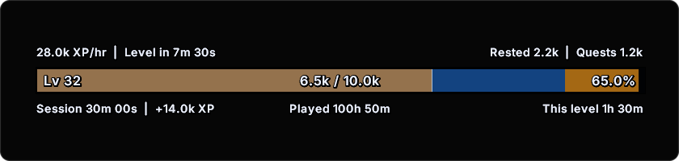
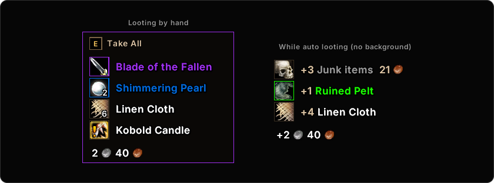
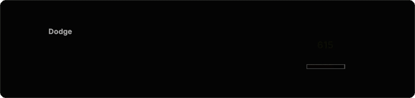
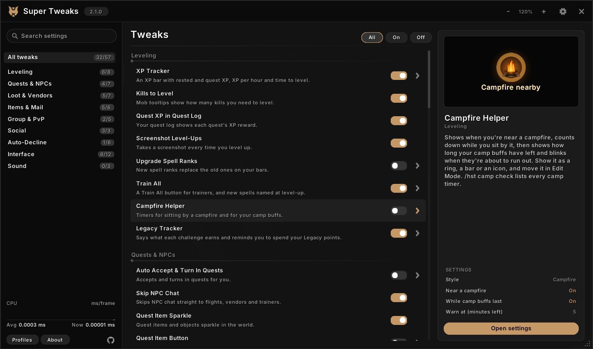

Opinionated and highly optimized quality-of-life tweaks for WoW Forever in one neat package.

More than 50 tweaks, from a campfire timer and an XP tracker to better tooltips and automatic junk selling, each one switched on and set up in a single settings window. It also loads on Classic Era.

Type `/hst` in game to open the settings. Each tweak can be turned on or off at any time without a `/reload`. Tweaks that act for you or replace part of the game's interface start off. The full list of tweaks and how each behaves is in [HastesSuperTweaks/README.md](HastesSuperTweaks/README.md).

## Highlights

### Campfire Helper

On WoW Forever, a campfire on screen shows when you're near a fire, counts down while you sit by it, then shows how long your camp buffs have left and blinks when they're about to run out. Show it as a ring, a bar or an icon. `/hst camp check` lists every camp timer.

### XP Tracker

An XP bar with rested XP, XP from completed quests, XP per hour and time to level. Mob tooltips say roughly how many more kills of that mob you need to level, and the quest log shows each quest's XP.

### Better Tooltips

A health bar under unit tooltips (in class colors, or green to red by health), borders in class colors, guild ranks and notes, and who the unit is targeting. On WoW Forever, your Recent Allies show where and when you last played together. Item tooltips can say how many you have in your bags and banks, and item, spell and NPC IDs are optional. Works with tooltip styles from other addons.

### Appearance Collector

On WoW Forever, a mark on gear whose look you haven't collected, in your bags, at vendors and in the Loot Window, and a line in item tooltips. Choose a hanger, shirt, sparkle or dot. Sell Clutter keeps that gear.

### Consumable Macros

Macros that always use your best food, drink, bandage and potions as your bags change, plus one that eats and drinks at once, a hunter's Feed Pet, and ones that put your best stone, oil or poison on each weapon. Drag them onto your action bars from the Macros window.

### Loot Window and Fast Loot

A compact loot list with a Take All button and hotkey. While you auto loot, it lists what you picked up for a few seconds. Fast Loot takes everything at once and still lets gathering trackers see the loot.

### Sell Junk and Sell Clutter

Greys are sold at any vendor. Sell Clutter also sells the items you collect while leveling and won't use:

- cooking ingredients and monster parts that none of your professions use
- other classes' reagents
- gear your class can't use
- food, potions and white gear you've outleveled

It keeps quest items, items your RestedXP guide needs, equipment sets, profession tools, expensive materials, anything that opens and gear whose look you haven't collected. Item tooltips say what will be sold, and `/hst clutter list` shows the full list before you reach a vendor.

### Better Scrolling Combat Text

Separate scroll areas for damage and healing you take and for notices: entering and leaving combat, low health and mana, combo points, auras, reputation, honor and skill-ups. Damage numbers can show on enemy nameplates. Choose fonts, colors, animations and filters, and move each area in Edit Mode.

## Settings window

- Point at a tweak in the list to see its description, a preview and its main settings beside it.
- Search finds any tweak or setting by name, description or menu choice. Switches work in the results, and Enter jumps to the setting.
- A live preview sits beside each tweak's settings and redraws as you change them.
- The cog in the title bar picks the window's theme: Graphite, Ember or Moonwell.
- Profiles hold every tweak's settings. Switch, copy and reset them, or share one as text.

## All tweaks

**Leveling:** XP Tracker, Kills to Level, Quest XP in Quest Log, Screenshot Level-Ups, Upgrade Spell Ranks (new ranks replace old ones on your bars), Train All, Legacy Tracker (Legacy points from each challenge, and a reminder to spend them), Campfire Helper (a campfire on screen that counts down sitting and your camp buffs).

**Quests and NPCs:** Auto Accept & Turn In Quests, Skip NPC Chat, Quest Item Sparkle, Quest Item Button (one button and key for your current quest's item), Quest Reward Value (marks the reward that sells for the most), Hide Quest Tracker (in dungeons, PvP, combat or always), Quest Progress Sounds (when an objective or a whole quest is done).

**Loot and vendors:** Loot Window, Movable Loot Rolls, Fast Loot, Sell Junk, Sell Clutter, Repair Automatically (guild funds optional), Restock at Vendors (ammo, reagents and poisons, and the vendor reagents your tracked recipes need, up to a gold limit per visit).

**Items and mail:** Consumable Macros (always your best food, drink, bandage and potion, plus Feed Pet and weapon stones, oils and poisons), Mail Expiry & Alt List, Mail Gold Guard (marks gold mailed by strangers so Open All skips it), Auto-Equip Bags, Bag Tweaks, Appearance Collector (marks gear whose look you haven't collected).

**Group and PvP:** Auto Accept Summons, Auto Accept Resurrection, Auto Release in Battlegrounds, Battleground Alerts (a countdown to enter, a gates alert and the match result in chat), Group Finder Whispers (class, level and race beside each whisper, with click-to-invite).

**Social:** Right-Click Guild Invite, Guild Message Popup, Chat Spam Filter (hides gold selling, boosting, recruitment and guilds you mute in public channels).

**Auto-decline:** Battle.net friend requests, duels, guild charters, join requests, party invites and shared quests. Friends, guildmates and community members can be let through.

**Interface:** Better Tooltips, Better Scrolling Combat Text, Better Breath Meter, Swing Timer Style (your colors for the game's swing timer, and bars that hide while idle), Better World Refresh (a countdown bar for WoW Forever's world refresh, with alerts and an automatic refresh at a safe moment), Druid Mana in Forms (your mana under the player frame in cat and bear form), Elite & Rare Markers (dragons and quest marks on nameplates, and a rare alert), Combo Points on Nameplates (rogues and druids), Error Message Filter, Minimap Button, Game Settings (camera distance, nameplate range, spell queue window, threat percentage, outlines, map fade and other settings the game's options don't show, reapplied at login, plus Edit Mode layout backups), Hide Issue Reporter.

**Sound:** Mute Mount Sounds, Mute Custom Sounds (rain, spell fizzle, or any sound file ID), Aura Sounds (a sound when the buffs or debuffs you choose appear or fade, in combat too).

## Install

1. Download the ZIP from the latest [release](../../releases).
2. Unzip it into your game's `Interface\AddOns` folder, so that you get `Interface\AddOns\HastesSuperTweaks`.
3. Restart the game.

What changed in each version is in [CHANGELOG.md](CHANGELOG.md), and in game: click the version beside the settings window's title.

## Contributing

Bug reports, ideas and pull requests are welcome: see [CONTRIBUTING.md](CONTRIBUTING.md). The addon is the `HastesSuperTweaks` folder. The scripts in `tools` need Python 3 (`python -m pip install -r tools/requirements.txt`):

- `python tools/install.py` installs the addon into the game. Set `HST_WOW_DIR` to your game folder (the one holding `Interface`). `--dry-run` shows what it would do.
- `python tools/bench.py` counts the work done on the addon's hot paths in a mocked game runtime (`tools/mockgame`). CI compares it on every pull request.
- `python tools/check.py` runs the consistency checks CI runs.
- `python tools/make_art.py` redraws the icons in `HastesSuperTweaks/Art`.

## License

The code is licensed under the [Mozilla Public License 2.0](LICENSE). The name and logo are not covered by it: see [TRADEMARKS.md](TRADEMARKS.md). The embedded libraries keep their own licenses, listed in [HastesSuperTweaks/Libs/THIRD-PARTY-LICENSES.txt](HastesSuperTweaks/Libs/THIRD-PARTY-LICENSES.txt).
