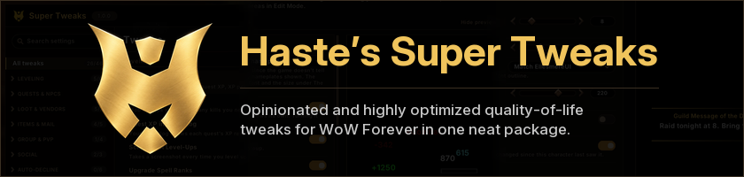

Opinionated and highly optimized quality-of-life tweaks for WoW Forever in one neat package.

More than 40 tweaks, from an XP tracker and better tooltips to a compact loot window and automatic junk selling, each one switched on and set up in a single settings window. It also loads on Classic Era.

Type `/hst` in game to open the settings. The full list of tweaks and how each behaves is in [HastesSuperTweaks/README.md](HastesSuperTweaks/README.md).

## Highlights

### XP Tracker

An XP bar with rested XP, XP from completed quests, XP per hour and time to level. Mob tooltips say roughly how many more kills of that mob you need to level, and the quest log shows each quest's XP.

### Better Tooltips

A health bar under unit tooltips, borders in class colors, guild ranks and notes, and who the unit is targeting. Item, spell and NPC IDs are optional. Works with tooltip styles from other addons.

### Loot Window and Fast Loot

A compact loot list with a Take All button and hotkey. While you auto loot, it lists what you picked up for a few seconds. Fast Loot takes everything at once and still lets gathering trackers see the loot.

### Sell Junk and Sell Clutter

Greys are sold at any vendor. Sell Clutter also sells the items you collect while leveling and won't use:

- cooking ingredients and monster parts that none of your professions use
- other classes' reagents
- gear your class can't use
- food, potions and white gear you've outleveled

It keeps quest items, items your RestedXP guide needs, equipment sets, profession tools, expensive materials and anything that opens. Item tooltips say what will be sold, and `/hst clutter list` shows the full list before you reach a vendor.

### Better Scrolling Combat Text

Separate scroll areas for damage and healing you take and for notices: entering and leaving combat, low health and mana, combo points, auras, reputation, honor and skill-ups. Damage numbers can show on enemy nameplates. Choose fonts, colors, animations and filters, and move each area in Edit Mode.

## All tweaks

**Leveling:** XP Tracker, Kills to Level, Quest XP in Quest Log, Screenshot Level-Ups, Upgrade Spell Ranks (new ranks replace old ones on your bars), Train All.

**Quests and NPCs:** Auto Accept & Turn In Quests, Skip NPC Chat, Quest Item Sparkle, Quest Reward Value (marks the reward that sells for the most), Hide Quest Tracker (in dungeons, PvP, combat or always).

**Loot and vendors:** Loot Window, Movable Loot Rolls, Fast Loot, Sell Junk, Sell Clutter, Repair Automatically (guild funds optional), Restock at Vendors (ammo, reagents and poisons, and the vendor reagents your tracked recipes need, up to a gold limit per visit).

**Items and mail:** Consumable Macros (always your best food, drink, bandage and potion), Mail Expiry & Alt List, Mail Gold Guard (marks gold mailed by strangers so Open All skips it), Auto-Equip Bags, Bag Tweaks.

**Group and PvP:** Auto Accept Summons, Auto Accept Resurrection, Auto Release in Battlegrounds, Battleground Alerts (a countdown to enter, a gates alert and the match result in chat), Group Finder Whispers (class, level and race beside each whisper, with click-to-invite).

**Social:** Right-Click Guild Invite, Guild Message Popup, Chat Spam Filter (hides gold selling, boosting and recruitment in public channels).

**Auto-decline:** Battle.net friend requests, duels, guild charters, join requests, party invites and shared quests. Friends, guildmates and community members can be let through.

**Interface:** Better Tooltips, Better Scrolling Combat Text, Better Breath Meter, Druid Mana in Forms (your mana under the player frame in cat and bear form), Elite & Rare Markers (dragons on nameplates and a rare alert), Error Message Filter, Minimap Button, Game Settings (camera distance, nameplate range, spell queue window and more, reapplied at login, plus Edit Mode layout backups), Hide Issue Reporter.

**Sound:** Mute Mount Sounds, Mute Custom Sounds (rain, spell fizzle, or any sound file ID).

## Install

1. Download the ZIP from the latest [release](../../releases).
2. Unzip it into your game's `Interface\AddOns` folder, so that you get `Interface\AddOns\HastesSuperTweaks`.
3. Restart the game.

What changed in each version is in [CHANGELOG.md](CHANGELOG.md), and in game: click the version beside the settings window's title.

## Contributing

Bug reports, ideas and pull requests are welcome: see [CONTRIBUTING.md](CONTRIBUTING.md). The addon is the `HastesSuperTweaks` folder. The scripts in `tools` need Python 3 (`python -m pip install -r tools/requirements.txt`):

- `python tools/install.py` installs the addon into the game. Set `HST_WOW_DIR` to your game folder (the one holding `Interface`). `--dry-run` shows what it would do.
- `python tools/bench.py` counts the work done on the addon's hot paths in a mocked game runtime (`tools/mockgame`). CI compares it on every pull request.
- `python tools/check.py` runs the consistency checks CI runs.
- `python tools/make_art.py` redraws the icons in `HastesSuperTweaks/Art`.

## License

The code is licensed under the [Mozilla Public License 2.0](LICENSE). The name and logo are not covered by it: see [TRADEMARKS.md](TRADEMARKS.md). The embedded libraries keep their own licenses, listed in [HastesSuperTweaks/Libs/THIRD-PARTY-LICENSES.txt](HastesSuperTweaks/Libs/THIRD-PARTY-LICENSES.txt).
